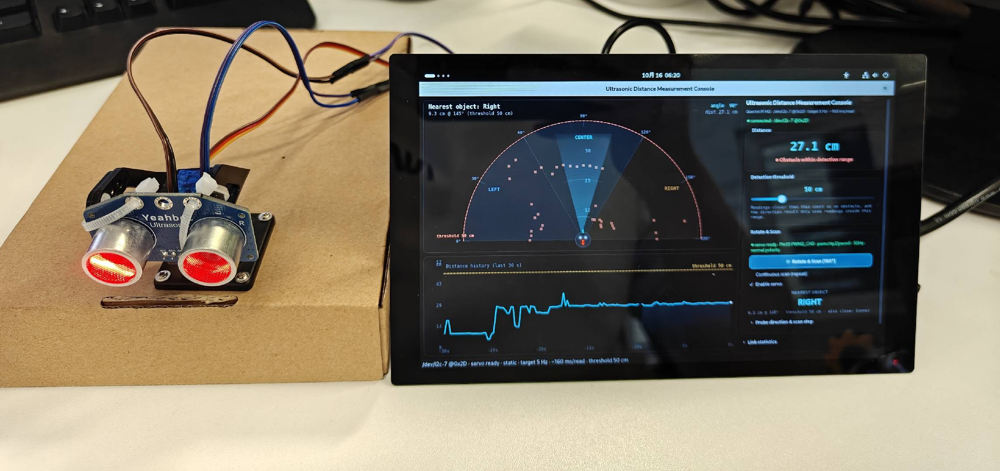
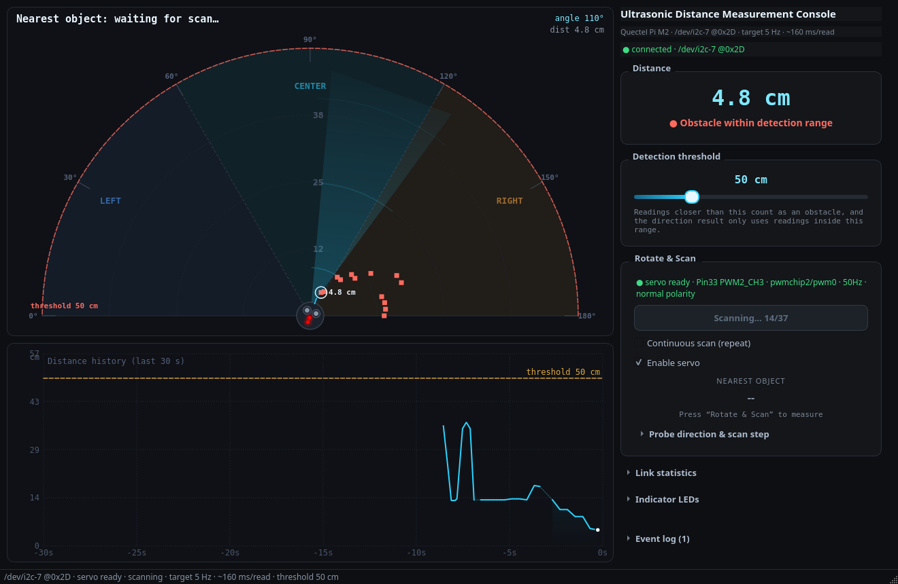

# 📡 超声波距离感知 Demo - Ultrasonic Distance Perception

[English](README.md) | 中文

本项目基于 [Quectel Pi M2 智能主控板](https://www.quectel.com.cn/product/quectel-pi-m2)开发。
幻彩 RGB 超声波模块经板载 I2C7 实时测距，舵机由硬件 PWM 驱动，带动探头在 0~180° 之间旋转扫描；
整圈读数按方位划分为**左 / 中 / 右**三个扇区，给出「最近的物体在哪一侧」的判定，
并在图形界面上以俯视极坐标图和距离曲线实时呈现。



## 🎯 功能特点

- **方位判定，而不只是测距**：结论只给 `LEFT` / `CENTER` / `RIGHT`，按扇区归纳后稳定不跳变
- **俯视极坐标扫描图**：圆心是可旋转的探头（R/T 换能器 + 两颗 RGB 灯），最近点高亮并标注距离
- **两种扫描方式**：单次扫描（默认，扫完回停靠位）与持续往复扫描，步进 5~45° 可调
- **运动平滑**：舵机走梯形速度曲线，大角度旋转不再有齿轮撞击声与电流尖峰
- **权限不足时拒绝出结论**：真超声 + 假舵机（未授权）时主动禁用持续扫描，不凭空编造方位
- **丢点优雅降级**：模块固有 5~7% 丢点，界面短时保持上次读数并标「保持」，曲线短缺口用虚线搭桥
- **无硬件也能跑**：`--sim` 仿真模式模拟真机耗时与「哪个方位有物体」，可先在开发机验证界面与判定
- **权限问题不崩**：拿不到 PWM 写权限时自动转仿真，并把可执行的修复命令直接显示在面板上
- **依赖只有一层**：运行期只需 `PySide6==6.9.1`；I2C 与 PWM 驱动只用 Python 标准库（PWM 直写 sysfs）

## 📋 系统要求

### 硬件要求

- Quectel Pi M2 智能主控板（Debian 13 出厂镜像，40-Pin 扩展口）
- 幻彩 RGB 超声波模块（I2C 地址 `0x2D`，量程 2~400cm）
- TXS0108 双向电平转换模块（模块为 5V 器件，主控 GPIO 为 3.3V，必须转换）
- SG90 / MG90S 类舵机（50Hz，脉宽 500~2500µs 对应 0~180°）
- 降压稳压模块（**多路独立输出**）—— 一路给主控板，另一路给舵机
- 7.4V 锂电池（2S），作降压稳压模块的输入
- 显示屏（或 HDMI 显示器）、USB 键盘鼠标、杜邦线若干
- 远程调试时用 SSH 终端（可选）：`ssh <用户名>@<板子 IP>`，板上目录为 `~/projects/demo-ultrasonic-sensing`

### 软件要求

- 操作系统：Debian 13（Quectel Pi M2 出厂默认系统镜像，无需重新烧录）
- Python：Python 3（板上用 `python3 -m venv` 创建隔离环境）
- 依赖组件：`PySide6 == 6.9.1`（唯一运行期依赖，见 `requirements.txt`）
- 外设节点：`/dev/i2c-7`（Pin27/Pin28）与 `/sys/class/pwm`（Pin33，PWM2_CH3）
- 读取 `/dev/i2c-7` 需要组权限：把当前用户加入 `i2c` 组后重新登录

## 🚀 安装与运行

1. 在智能主控板上打开终端，使用 git 克隆项目代码。

```bash
sudo apt update
sudo apt install -y git
git clone https://github.com/Quectel-Pi/demo-ultrasonic-sensing.git
```

执行完成后，当前目录下应生成 `demo-ultrasonic-sensing` 文件夹。

2. 进入项目目录，创建虚拟环境并安装依赖。

```bash
cd demo-ultrasonic-sensing
python3 -m venv .venv
.venv/bin/python -m pip install -r requirements.txt \
    -i https://mirrors.aliyun.com/pypi/simple/ --trusted-host mirrors.aliyun.com
```

> 板上系统自带的 python3 通常没有 pip 模块，且 sudo 需要密码，因此**不要**尝试
> `sudo apt install python3-pip`；`python3 -m venv` 创建的环境自带 pip。

3. 执行**一次**舵机 PWM 授权（内核 sysfs 的 PWM 通道默认仅 root 可写，需要 root 密码）。

```bash
sudo bash deploy/setup_servo_pwm.sh
```

4. 运行程序。

```bash
cd demo-ultrasonic-sensing
python3 run_scan.py
```

### 配置开机自启动（可选）

```bash
cp deploy/demo-ultrasonic-sensing.desktop ~/.config/autostart/
# 里面的 Exec 与 Path 已按 ~/projects/demo-ultrasonic-sensing 写好，路径不同就改这两行
```

## 🎛️ 使用说明

左列是扫描图与距离历史，右列是控制台。

- 右侧控制台常显 `Distance`（实时距离）、`Detection threshold`（探测阈值）、
  `Rotate & Scan`（扫描与结论）三个分组框，其余四个分区默认收起，点标题栏展开
- 点 `⟳ Rotate & Scan (180°)` 扫一圈并给出方位结论，扫完舵机回到 90° 停靠位；
  勾选 `Continuous scan (repeat)` 则一圈接一圈持续扫描
- `Enable servo` 可随时停止舵机输出；`Indicator LEDs` 可手动点亮模块的两颗 RGB 灯
- 拿不到 PWM 写权限时（未做第 3 步授权）程序会**主动禁用持续扫描**并在面板上给出修复命令：
  探头不会转时整圈读数来自同一方向，任何方位结论都不可信
- 结论区 `NEAREST OBJECT` 给出 `LEFT` / `CENTER` / `RIGHT`；所有可调参数都在 `src/config.py`
- 拿不到 PWM 写权限时（未做第 3 步授权）程序会**主动禁用持续扫描**并在面板上给出修复命令：
  探头不会转时整圈读数来自同一方向，任何方位结论都不可信

接线图见 `assets/wiring.svg`；舵机必须与主控板**分开供电并共地**（堵转电流可达 500~700mA，
共用一路会把 5V 拉低，导致超声波模块掉线）。



## 📁 项目结构

```
demo-ultrasonic-sensing/
├── run_scan.py            板上启动器（自动挑选含 PySide6 的解释器）
├── requirements.txt       依赖清单（只有 PySide6）
├── README.md              英文说明
├── README_zh.md           中文说明（本文件）
├── assets/                接线图、界面截图、演示录屏
├── deploy/
│   ├── setup_servo_pwm.sh             舵机 PWM 一次性授权（sudo）
│   └── demo-ultrasonic-sensing.desktop  桌面快捷方式 / 开机自启
└── src/
    ├── main.py            入口：参数解析 + 惰性导入 PySide6
    ├── config.py          全局配置：所有可调参数的唯一来源
    ├── driver/            驱动层：I2C 传输与协议、板载 PWM 舵机（含仿真回退）
    ├── controller/        控制层：采集、扫描状态机、方位判定
    ├── ui/                界面层：主窗口
    └── widgets/           视图层：扫描图、距离曲线、控制面板等
```

## 📚 更多文档

接线与供电细节、扫描耗时与方位判定原理、`src/config.py` 完整参数表、故障排查与设计说明，
见本示例在移远开发者文档平台的资料文档页。

## 📮 报告问题

如在使用过程中遇到问题，欢迎在 [Quectel Pi 开发专区](https://forumschinese.quectel.com/c/quectel-pi/58)
提交技术咨询，我们的技术支持团队将及时为您解答。

欢迎提交 Issue 和 Pull Request 来改进此项目。
